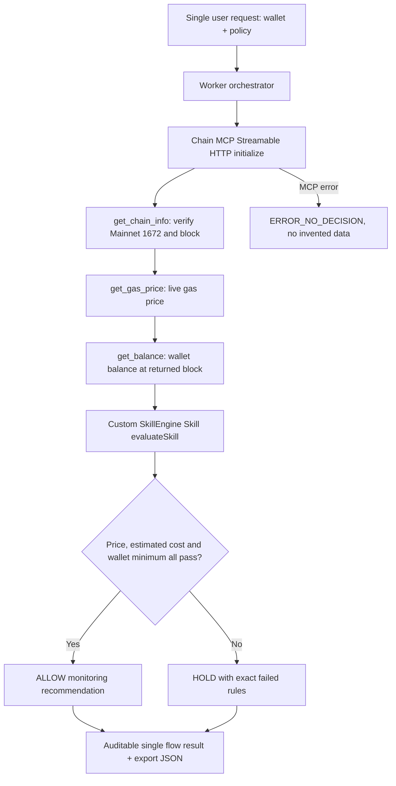

# Skill + Chain MCP Flow — Pharos Agent Arena

Live site: https://skill-chain-mcp-flow.trantanlong2411.workers.dev/

GitHub: https://github.com/trantanlong2411-droid/Skill-Chain-MCP-Flow

## Verified public proof

[View real hosted Chain MCP-to-Skill execution evidence](./proof/README.md), with ALLOW and HOLD on actual Pharos Mainnet data, three named MCP tool results per flow, and 12/12 automated tests passing.

[Verified GitHub Actions run 41595321180](https://github.com/trantanlong2411-droid/Skill-Chain-MCP-Flow/actions/runs/41595321180) includes a downloadable full JSON artifact.

## What is actually composed?

One HTTP request to the deployed Cloudflare Worker invokes one real **Pharos hosted Chain MCP** Streamable HTTP session, obtains Pharos Mainnet block and gas price and the account's on-chain PROS balance, then invokes an executable **custom SkillEngine-style skill** with those exact outputs. The skill decides ALLOW or HOLD based on configurable limits. The decision and its three source tool responses appear in a single machine-readable execution trace.

The composition is **not** a front-end that calls two independent systems side by side; the Skill requires outputs of the earlier MCP tools. It fails closed if the MCP call is unavailable or returns invalid chain information. No artificial chain data is substituted during live requests.

This uses the [official Pharos Chain MCP](https://github.com/PharosNetwork/pharos-mcp) hosted on `https://mcp.pharos.xyz/mcp`, which targets **Pharos Mainnet chain ID 1672** and PROS, not Pharos Atlantic Testnet 688689. Calls are read-only; no keys, wallets, approvals, signing, fee payments or broadcasts.

The `SKILL.md` file follows a Pharos SkillEngine-style convention. Logic is implemented in `src/skill.mjs` and executed by `src/worker.mjs`. This is a user-authored skill running in our Worker, not an unsupported claim that the remote SkillEngine service called the Skill.

## End-to-end flow diagram



The Skill's input is the literal live MCP outputs, so the chain tools must run before the Skill. The resulting ALLOW/HOLD is a read-only policy assessment, not permission to sign or spend.

## Reviewer demonstration

1. Open the [website](https://skill-chain-mcp-flow.trantanlong2411.workers.dev/). Use the public sample address or another EVM address.
2. Click **Demo: relaxed limits**. This initializes one hosted MCP session and retrieves three genuine tool results; a high cap and zero minimum wallet amount should yield ALLOW if MCP is healthy.
3. Click **Demo: strict limits**. Gas and cost caps are set to zero and wallet minimum is high; the exact same kind of live MCP outputs will normally cause HOLD, with the rule(s) highlighted.
4. Observe the same run's Mainnet chain ID, block, gas Gwei, PROS balance, estimated cost, Skill decision and all three individual rule results.
5. Expand **Complete machine-readable input → tool → skill chain**. The Skill input includes the numeric gas/balance fields from the earlier MCP steps, followed by an ALLOW/HOLD decision.
6. Click **Export execution proof JSON** to retain the audit evidence. The app also has browser-local history of up to 20 runs.
7. GitHub Actions independently invokes the **deployed Worker**, verifies its actual Chain MCP tool outputs match the Skill's input and output, and publishes a dated JSON proof artifact. Deterministic mock tests demonstrate that changing a live MCP field changes the decision.

If hosted Chain MCP becomes unavailable or rate-limited, the Worker returns an explicit error without pretending it obtained real data. There is no mock-data fallback in the public API.

## Match the four task requirements

| Agent Arena requirement | Evidence |
| --- | --- |
| Skill output depends on live Chain MCP data in the same flow | `runMcpComposition` produces three live official tool outputs, `evaluateSkill` directly consumes those objects and validates network and wallet address. |
| End-to-end from one user request | Browser submits one POST `/api/run`; Worker establishes MCP session and calls all tools, then the Skill returns a decision with no further user action. |
| Diagram or short write-up of tool order | Mermaid diagram above, `SKILL.md`, full API `trace` with method names, parameters, tool returns and Skill inputs. |
| Real data moving through both tools | GitHub Actions deployed integration validates actual MCP outputs and compares the Skill decision recomputed from these outputs, saving `pharos-skill-chain-mcp-live-proof`. |

## Security and accuracy notes

- Hosted Chain MCP uses mainnet 1672 / PROS. Do not mix mainnet data with Atlantic 688689.
- A typical sample wallet may have zero PROS; that is a legitimate balance from Chain MCP, not a failed request.
- `assumedGasUnits=21000` is a sample value, not the result of an on-chain estimate. The displayed estimated cost is arithmetic only.
- Gas price and balance are not atomic snapshots because `get_gas_price` returns latest, while `get_balance` is pinned to the block returned by `get_chain_info`. Values can change immediately. This is advisory only.
- The Skill never sends a transaction and cannot sign; it makes a monitoring-policy recommendation.
- The local `/api/health` endpoint checks the Worker itself, not whether external Chain MCP is accessible.
- The standalone SkillEngine runner is not invoked; the custom SKILL.md is executed as deterministic JS policy in our Worker.

## Local verification and CI

```sh
npm install
npm test
npm run build
npx wrangler deploy
```

CI workflow: https://github.com/trantanlong2411-droid/Skill-Chain-MCP-Flow/actions/workflows/verify.yml

Live proof appears under the passing GitHub Actions run's artifact section as `pharos-skill-chain-mcp-live-proof` (retained 30 days). Any live failure is recorded as an error, never a passing proof.

## References

- [Agent Arena — Skill + Chain MCP Flow](https://pharos-agent-arena.vercel.app/tasks/skill-chain-mcp-flow)
- [Pharos Chain MCP (hosted Streamable HTTP)](https://github.com/PharosNetwork/pharos-mcp)
- [Pharos SkillEngine](https://github.com/PharosNetwork/pharos-skill-engine)
- [MCP Streamable HTTP protocol](https://modelcontextprotocol.io/specification/2025-06-18/basic/transports)
