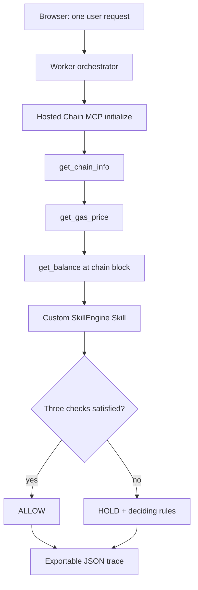

# Skill + Chain MCP Flow — verified end-to-end composition

Verified 03 November 2026, with actual hosted **Pharos Chain MCP** tool requests and a custom executable **SkillEngine-style Skill** in one application flow.

- [Try the live Worker](https://skill-chain-mcp-flow.trantanlong2411.workers.dev/)
- [GitHub Actions successful deployed integration run](https://github.com/trantanlong2411-droid/Skill-Chain-MCP-Flow/actions/runs/41595321180)
- [Saved machine-readable verification summary](./verified-run.json)
- [Custom Skill specification](../SKILL.md)
- [Executable decision engine](../src/skill.mjs)
- [Real Streamable HTTP MCP client](../src/mcp.mjs)
- [Flow description and diagram](../README.md)

## Task verification

| Requirement | Proof |
| --- | --- |
| Skill output depends on live Chain MCP data | Worker actually calls hosted MCP `get_chain_info`, `get_gas_price`, `get_balance`; the returned JSON fields are passed as inputs to `evaluateSkill()`. Integration test independently recalculates the decision from the returned tool output. |
| One user request completes the whole flow | Single browser POST to `/api/run` performs MCP initialization, three tool calls, then Skill evaluation. |
| Diagram or short write-up | The [README flow diagram](../README.md) shows the exact order; each live response includes five ordered trace records, including a Skill input/output trace. |
| Real on-chain data moves through both tools | GitHub Actions tested the deployed Cloudflare Worker against Pharos Mainnet chain 1672, not a local mock server, and saved the complete JSON artifact `pharos-skill-chain-mcp-live-proof`. |

## Actual observed live testnet? No: this is Pharos Mainnet

The hosted Pharos Chain MCP targets **Pharos Mainnet chain ID 1672**, native symbol PROS. It is distinct from Atlantic Testnet chain ID 688689 used by earlier tasks.

### Result A — relaxed policy

- UTC verification time: `2026-11-03 07:17:34.732`
- Latest Pharos block: `21993720`
- Live MCP gas price: `10 Gwei`
- Public sample address live MCP balance: `0 PROS`
- Skill decision: **ALLOW** (`ALL_RULES_PASSED`)
- Policy: max 1,000,000 Gwei, estimated cost cap 100 PROS, minimum wallet balance 0 PROS
- All three Chain MCP tool responses were included in the same flow before Skill execution.

### Result B — strict policy

- UTC verification time: `2026-11-03 07:17:38.199`
- Latest Pharos block: `21993725`
- Live MCP gas price: `10 Gwei`
- Public sample address live MCP balance: `0 PROS`
- Skill decision: **HOLD** due to both `GAS_PRICE_CEILING` and `COST_BUDGET`
- The user request reached the same three genuine Chain MCP tools and Skill calculation in the same sequence.

The full trace in the CI artifact includes the exact MCP tool outputs and the specific fields consumed by the Skill. This static summary is based on CI logs, not a replacement for their raw JSON.

## How the composition works

The full flow uses the **official hosted Chain MCP** via Streamable HTTP; it does **not** silently replace MCP tools with direct RPC calls. The custom Skill uses a standard `SKILL.md` convention with deterministic JavaScript execution inside the Worker, not the externally hosted SkillEngine runtime.

## Verify yourself

1. Open [the website](https://skill-chain-mcp-flow.trantanlong2411.workers.dev/).
2. Click `Demo: relaxed limits`. Expect ALLOW if live MCP is available and current gas fits the deliberately broad rule.
3. Click `Demo: strict limits`. Expect HOLD if the live gas quote is positive, as it was during the verification.
4. Inspect the decision, live gas, balance, block and rule outputs; then expand the full JSON trace. The Skill's inputs follow the Chain MCP results in the trace.
5. Export execution proof JSON. A new run can produce different block/gas/balance numbers; this is expected live-chain behavior.

The operation is **read-only** and never broadcasts an on-chain transaction. ALLOW means that the configured policy conditions were met, **not** that a wallet with 0 PROS can afford to execute a transaction. Gas cost is calculated as a theoretical `21000 × current_gas_price`, not as a gas-estimator tool result.

## Independent automated checks

- GitHub Actions run 41595321180: **12/12 unit tests pass**; Cloudflare build **SUCCESS**; both deployed hosted MCP + custom Skill flow scenarios **SUCCESS**.
- Integration tests re-evaluate the Skill using the actual MCP tool output, failing on mismatched chain, trace order, calculation or missing tool result.
- The downloadable raw evidence artifact `pharos-skill-chain-mcp-live-proof` is retained by GitHub Actions for 30 days.

No private keys, secrets, wallet signatures, transactions, claims of on-chain writes or transaction hashes were involved.
